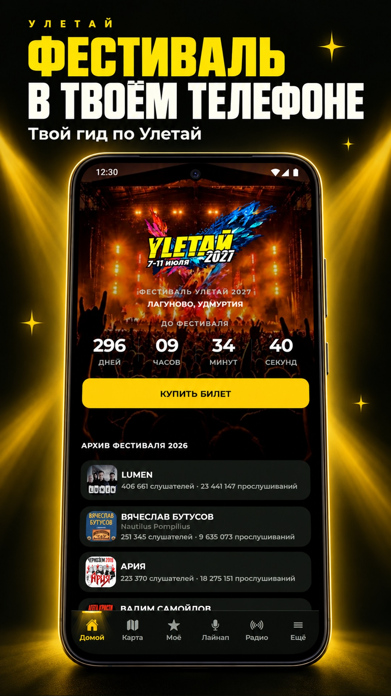
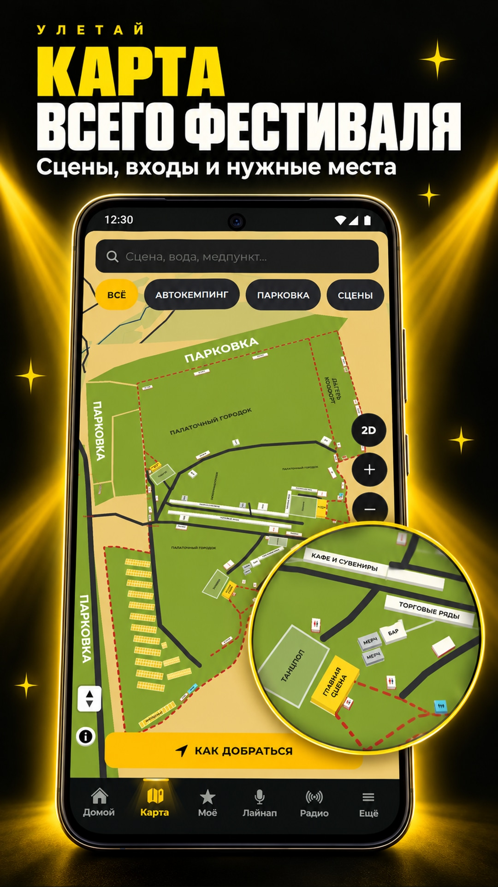
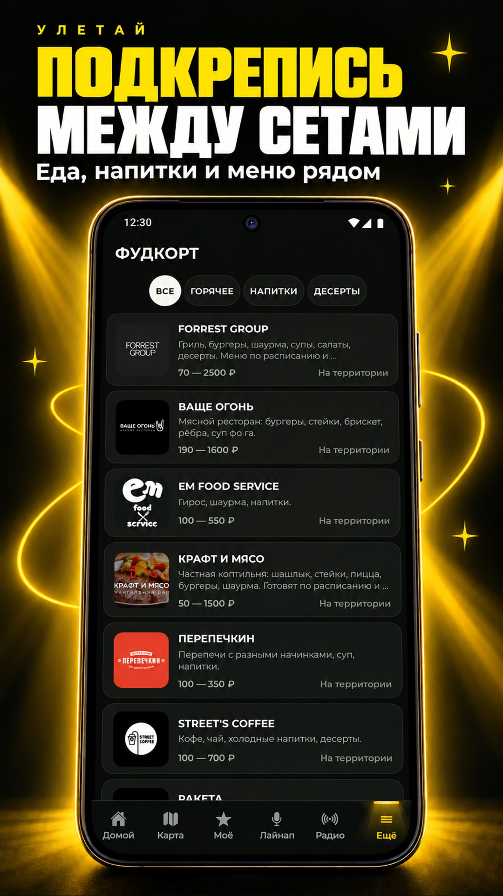
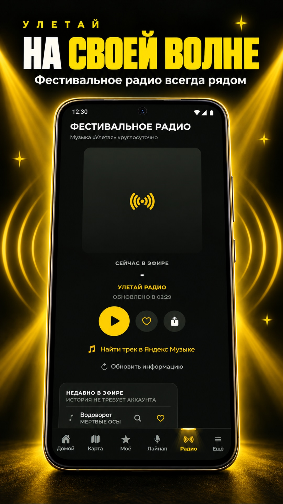
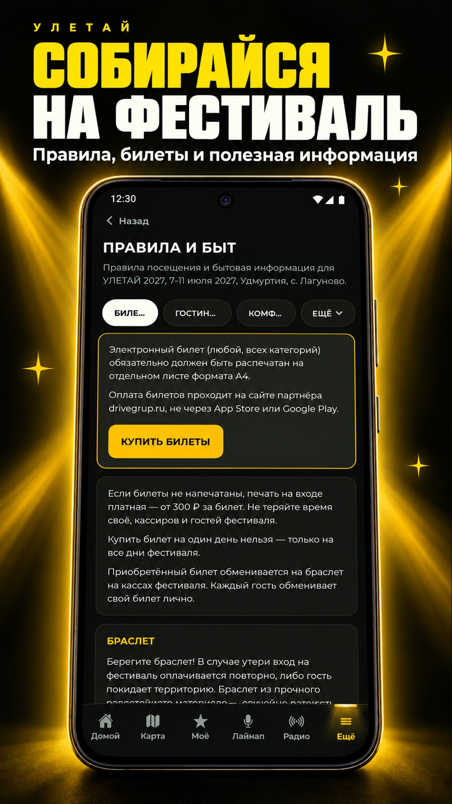
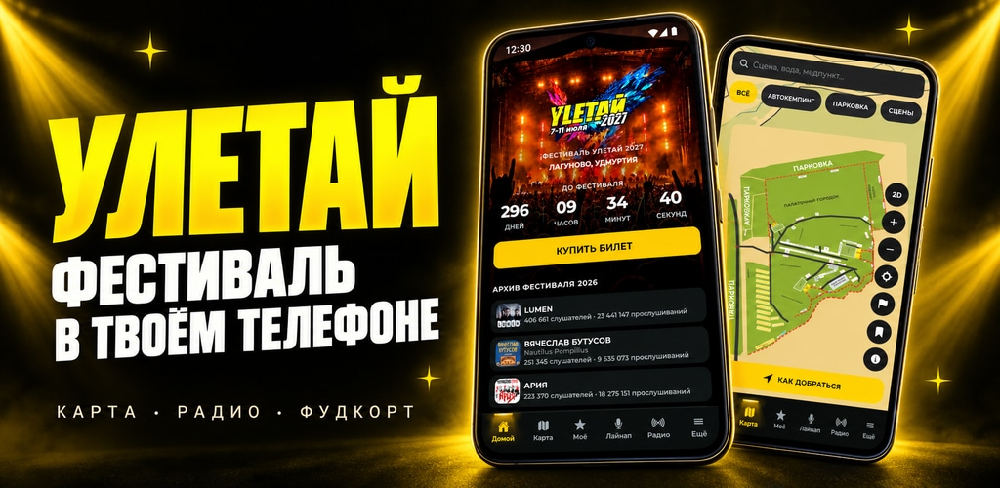

# Материалы магазинов для УЛЕТАЙ 1.0.12

Пять карточек 1080 × 1920 и обложка Google Play 1024 × 500. JPEG без прозрачности; размеры и контрольные суммы — в `assets-manifest.json`.

Исходные экраны сняты с https://uletayapp.ru 14 сентября 2026 года по времени Самары. Сайт в момент съёмки: релиз `91febddc1a7b8c7ab8f184b6fb1f292ff6e797cb`. На главной актуальные даты фестиваля 2027 и обозначенный архив 2026. Пустая программа нового года не использована в презентации.

Источники: главная `/`, карта `/map`, фудкорт `/foodcourt`, раздел правил `/rules`, радио через нижнюю панель приложения. Экран радио показывает фактическое состояние эфира в момент съёмки. Телефоны, фон, заголовки и увеличенный фрагмент карты оформлены с помощью генерации изображений.

Файлы для загрузки находятся в `upload/`. Описание приложения и текст обновления сохранены рядом. Исходные PNG и необработанные снимки сохранены локально и исключены из Git и EAS-архива.

