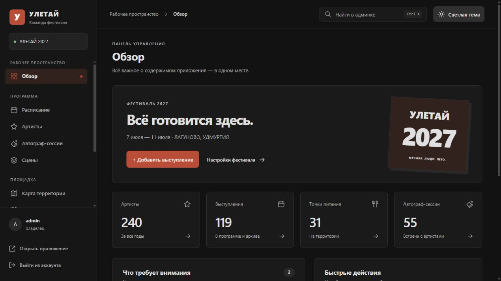
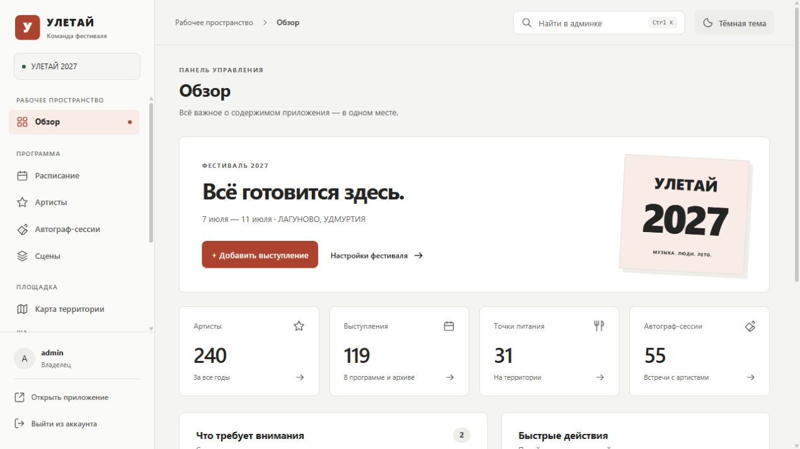
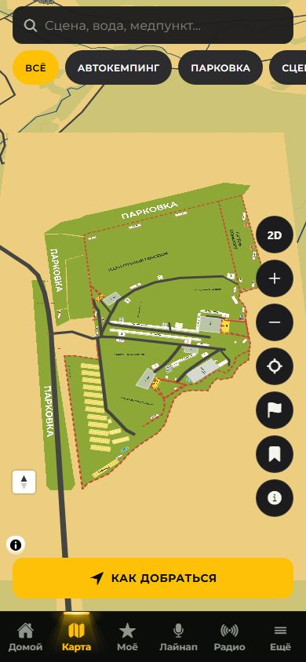

# Подготовка проекта к поддержке

Дата: 16 октября 2026 года. Изменения подготовлены локально; сервер, публикации и Git-история не изменялись.

## Что изменено

- Сохранено разделение на Expo-приложение и Next.js CMS. Границы, путь данных, хранение контента и особенности сборки описаны в [архитектуре](ARCHITECTURE.md).
- Авторизация выделена из общего файла действий в отдельный модуль. Cookie проверяется по серверной сессии и активности пользователя в MySQL. Выход и отзыв доступа закрывают сессии.
- Добавлены вход через VK ID с PKCE, список разрешённых VK ID и раздел «Доступы» для владельца. Права проверяются также при прямом вызове серверных действий.
- Админка оформлена по образцу rust-admin: нейтральные поверхности, терракотовые основные кнопки, единые поля, таблицы и состояния. Светлая/тёмная тема сохраняется между посещениями. Цвета вынесены в `styles/theme.css`, компоновка отделена от темы.
- Проверены мобильное меню и все десять разделов на ширине 320 px; полям и кнопкам заданы удобные размеры для касания.
- На карте уменьшен нижний отступ кнопки «Как добраться»: 16 px вместо 56 px. Авторство карты расположено выше кнопки; положения web и нативных элементов используют общую настройку.
- Установка и миграции БД читают `.env`; добавлена повторяемая миграция доступа, сохраняющая существующих пользователей и пароли. Добавлена настройка порта MySQL.
- Выдача изображений объединена: проверяется допустимый формат, выход из каталога и символьные ссылки. Загрузка с cookie требует совпадения Origin, включая работу за nginx.
- Исправленные версии серверных зависимостей закреплены в lock-файле; обновлены совместимые пакеты Expo SDK 57. После обновления навигации добавлена проверка готовности её состояния.
- Добавлены ручные конфигурации PM2/nginx и подготовка static/public/data для standalone CMS. В существующую схему выпуска передаются параметры VK и MySQL.
- Служебные настройки инструментов вынесены из исходников в локальную резервную папку `tmp/handover-backup`. Старые планы и отчёты перенесены в `docs/archive`; архивные пути выпусков приведены к нейтральному виду. Рабочие наработки и предыдущие незакоммиченные изменения сохранены.
- Добавлен `npm run handover`: архив по списку разрешённых исходников без окружений, приватных ключей, сборок, рабочих данных, истории Git и локальных черновиков.
- Добавлены шесть публичных инструментов WebMCP и генерируемые `llms.txt`, AI Catalog в корне и `/.well-known/`, руководство и JSON-схемы инструментов. Источники спецификаций, ограничения браузеров и проверка описаны в [AI-DISCOVERY.md](AI-DISCOVERY.md).

## Проверки

| Проверка | Результат |
| --- | --- |
| TypeScript приложения и CMS, ESLint | Без ошибок |
| Основные регрессионные тесты `npm test` | Пройдены |
| Установка в отдельную БД и повторные миграции | Пройдены; контент сохранён |
| Авторизация на настоящем MySQL | Пароли, роли, VK ID, хеши токенов, отзыв, повторная выдача и выход проверены |
| HTTP-проверки CMS | Анонимный доступ, роли, прямое действие выдачи доступа, Origin, отозванные cookie/Bearer и неверный VK callback проверены |
| Браузер | Неверный и верный пароль, сохранение формы, темы после перезагрузки, выдача/отзыв тестового доступа, мобильное меню |
| Адаптивность | Все десять разделов без горизонтального переполнения на ширине 320 px; дополнительно 390 px и desktop |
| Карта | Данные, рендерер, размещение и маршруты; 264/264 и 2464/2464 маршрутов. Отступ кнопки 16 px, открытие маршрута и авторства проверены в браузере на 320 и 390 px |
| Радио | 7/7 тестов |
| Production web | Сборка и SEO-проверка 301 URL пройдены |
| Экспорт Expo Android/iOS | Обе Hermes-сборки JavaScript созданы; проверка на устройствах выполняется отдельно |
| Production CMS | Сборка standalone со статическими файлами пройдена |
| Запуск standalone CMS | На локальном порту проверены API, вход, права, стили и файлы рендерера карты |
| `npm audit` CMS | Известных уязвимостей не обнаружено |
| Конфигурации Bash | Синтаксис новых и изменённых скриптов проверен |
| WebMCP и обнаружение ресурсов | Шесть инструментов, схемы параметров, жизненный цикл API, генерация и 16 HTTP-ссылок проверены; настоящий браузерный WebMCP-вызов ещё не подтверждён |
| Совместимость мобильных клиентов | Исходники 1.0.12/1.0.15/1.0.16 приняли новую CMS; проверены 200/304, радио, 235 изображений, форматы push и сохранность данных при миграции. [Подробности и существующий 404](COMPATIBILITY.md) |

Тесты БД и браузера выполнялись на отдельном локальном экземпляре MariaDB с тестовыми данными. Реальная база проекта и внешний сервер не изменялись.

## Что проверить перед рабочим выпуском

1. **VK ID.** Публичный ID приложения взят из локальной конфигурации такси. Точный адрес возврата для рабочего домена описан в [AUTH.md](AUTH.md). Зарегистрировать домен и пройти настоящий вход VK из этой среды не удалось: кабинет заблокирован для браузерного инструмента, запрос к API с найденным пользовательским токеном не завершился. Положительный протокол обмена кода проверен с изолированными ответами VK; полноценный внешний вход ещё требует проверки.
2. **Нативные приложения.** Перед публикацией необходим запуск release-сборок Android/iOS на устройствах, включая карту, фон, push и радио. JavaScript-экспорт не подтверждает работу нативных бинарных файлов.
3. **Зависимости инструментов.** После совместимых обновлений аудит Expo-дерева показывает 30 предупреждений (22 high, 8 moderate), в том числе цепочки `braces`, `node-forge`, `uuid` и `image-size`. Автоматический `--force` предлагает несовместимый откат Expo/React Native. Такой откат не применялся. Серверное дерево CMS проверяется отдельно и чистое. Повторите аудит при плановом обновлении SDK; не включайте dev-серверы сборки в публичный доступ.
4. **Новый Linux-сервер.** Реальный перенос, выпуск сертификата и настройка cron не выполнялись. Следуйте README, перенесите MySQL и uploads вместе, проверьте права файлов, HTTPS, автозапуск и восстановление копии до переключения DNS.

## Вид админки

[Мобильная версия](images/admin-mobile-dark.jpg).

## Кнопка маршрута на карте

